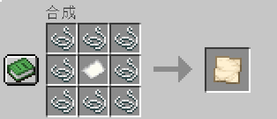
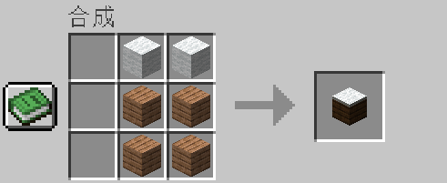
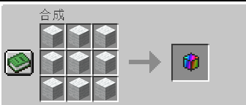

# PixelArt

PixelArt is a Fabric mod for Minecraft 26.3 that turns images into Minecraft pixel art. It provides two ways to create artwork:

- **Creative mode:** use `/pixelart` to generate a detailed 128x128 pixel-art canvas quickly.
- **Survival mode:** craft and use the Painting Table to create a Painted Canvas using materials and time.

The mod is designed for Java Edition, Fabric Loader 0.20.1 or newer, Fabric API, and Java 25 or newer.

## Installation for players

You only need Minecraft Java Edition, Fabric, Fabric API, and the PixelArt mod.

1. Install **Minecraft Java Edition 26.3**.
2. Install **Fabric Loader 0.20.1 or newer** for Minecraft 26.3.
3. Download the matching **Fabric API** `.jar`.
4. Download the PixelArt mod `.jar`.
5. Open your Minecraft `mods` folder:
   - Windows: `%APPDATA%\.minecraft\mods`
   - macOS: `~/Library/Application Support/minecraft/mods`
   - Linux: `~/.minecraft/mods`
6. Put both the Fabric API JAR and the PixelArt JAR into that folder.
7. Start Minecraft with the **Fabric 26.3** profile.

Java 25 or newer is required by Minecraft 26.3. Most current Minecraft launchers install or select the correct Java runtime automatically.

To use images, create a folder named `mapart` inside the Minecraft game directory and place PNG, JPG, or JPEG files there. Restart Minecraft after adding or replacing the mod.

## Creative mode: `/pixelart`

For fast building and testing, use:

```text
/pixelart <image>
```

Optional coordinates can be supplied:

```text
/pixelart <image> [x y z]
```

The command reads the image from the `mapart` folder, scales it to 128x128 pixels, and places the result as colored `pixel_block` blocks. The command is recommended for creative mode because it is immediate and does not require gathering materials.

The generated pixel blocks can be used to make a Better Map or to construct a physical canvas. Image placement is progressive to reduce sudden performance spikes, but large images can still create significant block-update and rendering work.

## Added items and blocks

### Pixel Block

The Pixel Block is the mod's full-color building block. It has 256 color states and is used to reproduce the colors of an image in a physical 128x128 pixel-art canvas. Pixel Blocks are also the material consumed by the Painting Table.

### Painting Table

The Painting Table is the main survival workstation. It stores Pixel Blocks, accepts a Blank Canvas, and progressively builds a Painted Canvas from an image selected from the `mapart` folder. Its inventory and canvas slots are persistent, so construction can pause and resume.

### Better Map

The Better Map is a map-compatible item for the creative/map workflow. It can capture a Pixel Block canvas and display the artwork as a full-color map-style image. It is useful when creating artwork quickly with `/pixelart`.

### Filled Better Map

The Filled Better Map is the filled/display form of the Better Map. It stores the captured image and can be held or displayed in an item frame like a filled map.

### Blank Canvas

The Blank Canvas is the survival input item for the Painting Table. Craft one with string and paper, place it in the table's Blank slot, and select an image to begin construction.

### Painted Canvas

The Painted Canvas is the finished survival output. It stores the completed 128x128 image snapshot and is intended to be used and displayed like a filled map. Once created, it does not automatically change if the original Pixel Blocks are edited.

## Survival mode: Painting Table

The Painting Table is the intended survival workflow. It consumes Pixel Blocks from its table inventory and progressively creates a Painted Canvas.

### Survival workflow

1. Craft a **Painting Table**.
2. Craft a **Blank Canvas**.
3. Craft or collect **Pixel Blocks**.
4. Place the Painting Table.
5. Put Pixel Blocks into the table inventory.
6. Put the Blank Canvas into the **Blank** slot.
7. Enter or select an image filename from the `mapart` folder.
8. Click **Create Canvas**.
9. Wait while the table builds the image.
10. Take the finished **Painted Canvas** from the **Painted** output slot.

The table requires one Pixel Block for each 100 image pixels. A full 128x128 image requires **164 Pixel Blocks**. The table pauses when it runs out of Pixel Blocks and can continue after more are supplied.

Painted Canvases preserve the captured 128x128 image and are intended to be displayed like a filled map, including in item frames.

## Recipes

### Blank Canvas



This recipe produces **1 Blank Canvas item**.

### Painting Table



### Pixel Block



One Pixel Block represents the material allowance for 100 rendered image pixels.

## Commands

```text
/pixelart <image> [x y z]
```

Builds a full-color pixel-art image from the `mapart` folder.

```text
/mapart <image> [x y z] [shaded]
```

Builds an image using the map-art material palette and optional height shading.

Use the creative commands for rapid testing and large builds. Use the Painting Table for a survival-friendly progression with crafting costs, inventory storage, and progressive construction.

## Performance notes

- Use 128x128 source images for the intended canvas size.
- Avoid starting many large render jobs at once.
- Let a build finish before starting another large image.
- Existing maps and canvases store a snapshot; changing the blocks later does not automatically update an already-created filled item.
- If a world was open while replacing the mod JAR, restart Minecraft before testing the new version.

## Project information

- Minecraft: `26.3`
- Fabric Loader: `0.20.1`
- Fabric API: `0.165.0+26.3`
- Java: `25+`
- Mod ID: `woolmapart`
