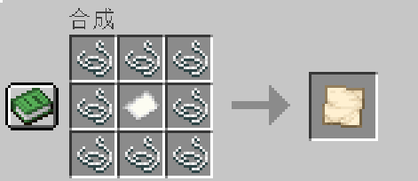
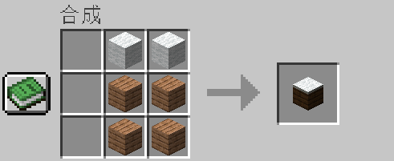
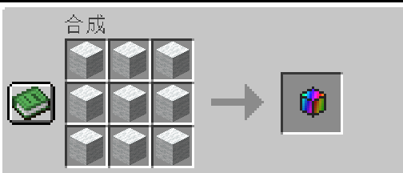

# PixelArt

PixelArt 是一个适用于 Minecraft 26.3 的 Fabric 模组，可以将图片转换为 Minecraft 像素艺术。模组提供两种创作方式：

- **创造模式：** 使用 `/pixelart` 快速生成详细的 128x128 像素画。
- **生存模式：** 制作并使用绘画台，通过材料和时间制作已绘制画布。

本模组面向 Minecraft Java 版，需要 Fabric Loader 0.20.1 或更高版本、匹配的 Fabric API，以及 Java 25 或更高版本。

## 安装

1. 安装 Minecraft Java 版 26.3。
2. 安装 Fabric Loader 0.20.1 或更高版本。
3. 安装匹配版本的 Fabric API。
4. 安装 Java 25 或更高版本。
5. 将 `woolmapart-1.0.0.jar` 放入 `.minecraft/mods` 文件夹。
6. 在 Minecraft 游戏目录旁创建 `mapart` 文件夹，并将图片放入其中。

支持的图片格式：PNG、JPG 和 JPEG。

## 创造模式：`/pixelart`

使用以下命令快速生成像素画：

```text
/pixelart <图片文件名>
```

也可以指定生成位置：

```text
/pixelart <图片文件名> [x y z]
```

命令会从 `mapart` 文件夹读取图片，将其缩放为 128x128 像素，并使用彩色 `pixel_block` 方块生成画面。该命令适合创造模式，因为它不需要收集材料，可以快速测试和生成大型作品。

生成的像素方块可以用来制作 Better Map，也可以用于构建实体画布。生成过程会逐步进行，以减少瞬间卡顿，但大型图片仍然可能带来较高的方块更新和渲染负载。

## 生存模式：绘画台

绘画台是本模组推荐的生存模式流程。它会消耗内部库存中的像素方块，并逐步制作一张已绘制画布。

### 生存模式流程

1. 制作 **绘画台**。
2. 制作 **空白画布**。
3. 制作或收集 **像素方块**。
4. 放置绘画台。
5. 将像素方块放入绘画台库存。
6. 将空白画布放入 **Blank** 输入槽。
7. 输入或选择 `mapart` 文件夹中的图片文件名。
8. 点击 **Create Canvas**。
9. 等待绘画台完成制作。
10. 从 **Painted** 输出槽取出 **已绘制画布**。

绘画台每 100 个图片像素需要 1 个像素方块。完整的 128x128 图片需要 **164 个像素方块**。如果库存中的像素方块不足，制作会暂停；补充材料后可以继续。

已绘制画布会保存 128x128 的图片快照，可以像已填充地图一样拿在手中或放入物品展示框中。

## 新增物品和方块

### 像素方块（Pixel Block）

像素方块是模组的全彩建筑方块，共有 256 种颜色状态。它用于还原图片颜色、构建实体 128x128 像素画，也会被绘画台消耗。

### 绘画台（Painting Table）

绘画台是主要的生存模式工作站。它可以存放像素方块、接收空白画布，并根据 `mapart` 文件夹中的图片逐步制作已绘制画布。库存和画布槽位会保存，制作可以暂停后继续。

### Better Map

Better Map 是适用于地图流程的模组物品，可捕获像素方块画布并以全彩地图样式显示作品，适合配合 `/pixelart` 使用。

### Filled Better Map

Filled Better Map 是 Better Map 的已填充显示形态。它会保存捕获的图片，可以像已填充地图一样拿在手中或放入物品展示框。

### 空白画布（Blank Canvas）

空白画布是绘画台的生存模式输入物品。使用线和纸制作后，将其放入绘画台的 Blank 槽，再选择图片即可开始制作。

### 已绘制画布（Painted Canvas）

已绘制画布是绘画台完成后的生存模式输出物品。它保存完成后的 128x128 图片快照，可以像已填充地图一样使用和展示。制作完成后，原来的像素方块发生变化不会自动更新已经生成的画布。

## 配方

### 空白画布



这个配方会制作 **1 个空白画布**。

### 绘画台



### 像素方块



## 命令

```text
/pixelart <图片文件名> [x y z]
```

从 `mapart` 文件夹读取图片并生成全彩像素画。

```text
/mapart <图片文件名> [x y z] [shaded]
```

使用地图艺术材料调色板生成图片，并可选择高度阴影效果。

创造模式推荐使用命令进行快速测试和大型建造；生存模式推荐使用绘画台，通过配方、材料库存和逐步制作完成作品。

## 性能提示

- 建议使用 128x128 的图片。
- 不要同时启动多个大型生成任务。
- 在开始下一张大图片前，先等待当前任务完成。
- 已创建的地图和画布保存的是图片快照；之后修改方块不会自动更新已经创建的物品。
- 替换模组 JAR 后，如果 Minecraft 正在运行，请重启游戏再测试新版本。

## 项目信息

- Minecraft：`26.3`
- Fabric Loader：`0.20.1`
- Fabric API：`0.165.0+26.3`
- Java：`25+`
- Mod ID：`woolmapart`

> 当前文件只翻译 README 文档。游戏内文字的中文本地化将在之后单独完成。
